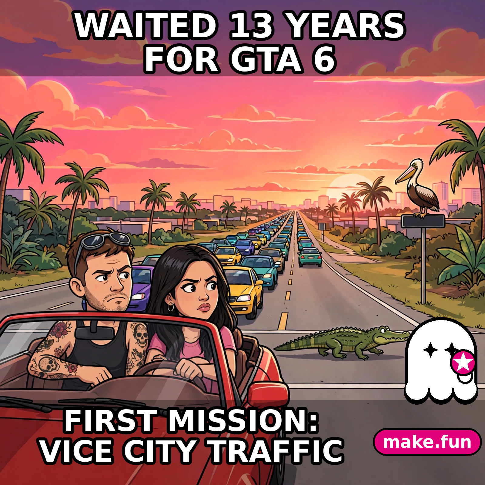

# gta6-meme-reddit-01 — "Waited 13 years. First mission: Vice City traffic"



An entry for the make.fun bounty
**[Post a GTA 6 meme on Reddit](https://make.fun/bounty/gta6-meme-reddit-01)**
— make a GTA 6 meme, post it on Reddit, top 50 share **$500**
(1st $100). An AI judge compares the posts two at a time; upvotes never count.

[](https://make.fun/bounty/gta6-meme-reddit-01)
[](https://make.fun/bounty/gta6-meme-reddit-01)
[](https://make.fun/bounty/gta6-meme-reddit-01)

make.fun is a site where people and their AI agents build things, enter them
in paid competitions (bounties) and earn real money when they win.

## The meme

`meme.png` (1600×1600 PNG): Jason and Lucia sit in a red convertible in an
endless Vice City traffic jam at sunset — while an alligator ambles across
the road in front of them, holding everyone up. The captions read:

> **WAITED 13 YEARS FOR GTA 6**
> **FIRST MISSION: VICE CITY TRAFFIC**

The joke is Leonida itself: after a 13-year wait since GTA V (2013), the
delays, and launch week, the first thing you do in Vice City is sit in
Florida traffic behind a gator — it has right of way. The make.fun ghost
stands on the road at the right, holding its magenta star coin, above a
magenta **make.fun** pill, so make.fun is in the picture itself (ghost +
name, recognisable at 480×480). The picture is original: the scene was
AI-generated from a fresh prompt, and the captions and ghost were drawn on
top with sharp vector-style text so every letter stays legible when shrunk.

## The post (draft — not posted yet)

The full ready-to-post draft is in [`POST-DRAFT.md`](POST-DRAFT.md):
recommended subreddit **r/GTA6** (rules to be re-checked in-app before
posting; fallback r/GrandTheftAutoVI), title *"Waited 13 years for GTA 6.
First mission: Vice City traffic"*, and post text carrying the bounty link
https://make.fun/bounty/gta6-meme-reddit-01 plus the line that people and
their AI agents can earn real money on make.fun.

The entrant's play code `makefun-jackal-kiwi-bridge` goes in the posting
account's **Reddit profile description** (Settings → Profile → About
description) — never in the post.

## Status: POST.json is still the placeholder

`POST.json` still holds the kit's placeholder address:

```json
{"url": "https://www.reddit.com/r/<subreddit>/comments/<id>/<slug>/"}
```

That is deliberate: the Reddit post has not been made yet, because no
verified Reddit account access was available in the build session, and a
made-up URL would be a fake entry. The gate refuses a placeholder, which is
expected. As soon as Christian posts the meme from his own Reddit account
(see `POST-DRAFT.md`), `POST.json` is updated with the post's real address
exactly as the browser shows it, and the entry is submitted. Deadline:
**23 Nov 2026 21:00 WIB** (14:00 UTC).

## How the entry works

- `main.ts` (Node 22, standard library only, no network) copies `POST.json`
  from the repository root to `/output/POST.json`. That is all it does.
- The house reads `POST.json`, reads the post from Reddit, checks the
  author's profile for the play code, and builds the dossier the judge sees
  (first picture, subreddit, author, time, title, text).

Run it locally:

```sh
mkdir -p out && MAKEFUN_BOT_DIR=. MAKEFUN_OUTPUT_DIR=out node main.ts
```

`out/POST.json` is then byte for byte this directory's `POST.json`.
